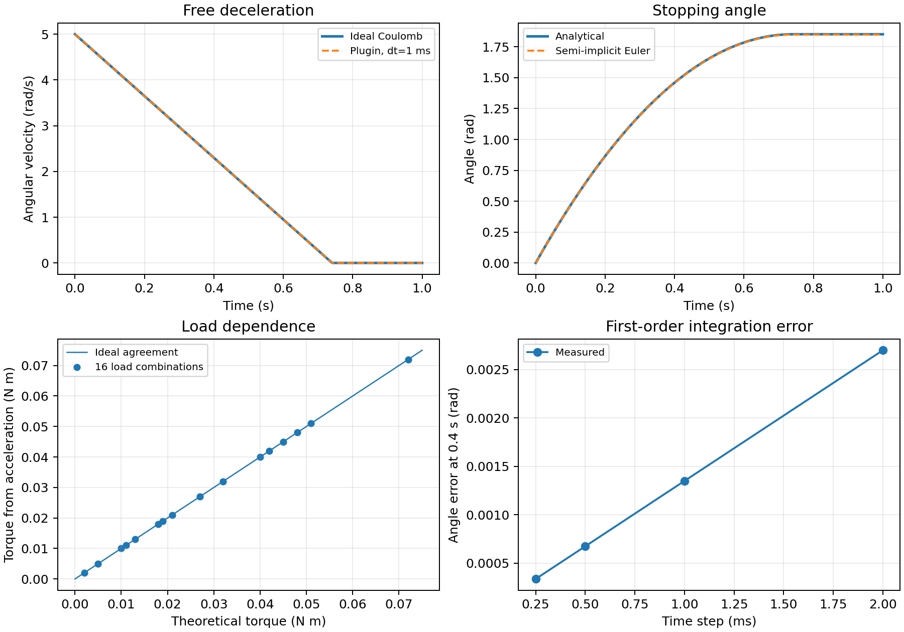

# mjhinge

独立的 MuJoCo C++ 铰链摩擦插件。加载动态库并在 MJCF 中配置后，直接调用 `mj_step()` 即可运行，仿真循环不需要额外计算载荷或更新摩擦。

插件名为 `mjhinge.hinge_friction`。每个实例关联一个已命名的 `hinge` 关节，支持载荷相关摩擦、可选的低速静摩擦增强和角度相关径向增益；关节原有的 `frictionloss` 和 `damping` 继续生效。新增项默认关闭，原有配置继续有效。

## MJCF 配置

```xml
<mujoco model="hinge_example">
  <extension>
    <plugin plugin="mjhinge.hinge_friction">
      <instance name="hinge_friction">
        <config key="joint" value="hinge"/>
        <config key="radial_gain" value="0.00045"/>
        <config key="axial_gain" value="0.00060"/>
      </instance>
    </plugin>
  </extension>

  <worldbody>
    <body name="link" pos="0 0 1">
      <joint name="hinge" type="hinge" axis="0 1 0"
             frictionloss="0.0015" damping="0"/>
      <geom type="capsule" fromto="0 0 0 0.3 0 0"
            size="0.025" mass="0.2"/>
    </body>
  </worldbody>
</mujoco>
```

| 参数 | 含义 | 单位 | 默认值 |
| --- | --- | --- | --- |
| `joint` | 关联的 hinge 关节名 | — | 必填 |
| `radial_gain` | 径向载荷到摩擦力矩的等效系数 | N·m/N，即 m | 0 |
| `axial_gain` | 轴向载荷到摩擦力矩的等效系数 | N·m/N，即 m | 0 |
| `static_extra` | 低速附加摩擦上限 | N·m | 0 |
| `stribeck_velocity` | 附加摩擦衰减的速度尺度，必须为正 | rad/s | 0.02 |
| `radial_peak_gain` | 高斯形径向增益幅值 | m | 0 |
| `radial_peak_angle` | 径向增益峰值所在角度 | rad | 0.7 |
| `radial_peak_width` | 径向增益角度宽度，必须为正 | rad | 0.2 |
| `body_force_sensors` | 可选的 plugin sensor 名列表，空格分隔；每个输出 `3*nbody` 个世界坐标系力分量 | N | 空 |
| 关节 `frictionloss` | MuJoCo 原有的关节摩擦力矩上限 | N·m | MuJoCo 默认值 |

两个 gain 必须为有限非负数，已经包含有效摩擦半径。多个关节分别配置多个实例；同一个关节只能配置一个实例。关联关节必须是所在刚体与父刚体之间唯一的关节，以便明确解释关节反力。

## 摩擦模型

每一步的摩擦力矩上限为：

```text
gain(q) = radial_gain + radial_peak_gain * exp(-0.5*((q-radial_peak_angle)/radial_peak_width)^2)
T_limit[n] = frictionloss + gain(q) * F_radial[n-1]
                         + axial_gain * F_axial[n-1]
                         + static_extra * exp(-(qvel/stribeck_velocity)^2)
```

载荷来自 `mj_rnePostConstraint` 计算的关节传递力 `cfrc_int`，并补偿 MuJoCo 3.9 未计入的空间肌腱走线点作用力。在世界坐标系下，令关节轴单位向量为 `a`、关节传递力为 `F`：

```text
F_axial  = abs(dot(F, a))
F_radial = norm(F - dot(F, a) * a)
```

外部 cable 插件可以通过 `body_force_sensors` 报告施加到各刚体的物理力。传感器必须为 plugin sensor，维度为 `3*nbody`，按 body ID 顺序输出世界坐标系的 `[Fx,Fy,Fz]`；同一个传感器在多个关节实例中配置时只统计一次。传感器开启时，插件将这些力沿刚体子树汇总以补全轴承载荷；配置了此接口时不允许禁用传感器。mjhinge 不链接 cable 库，不配置该接口即可独立使用。

有限半径圆弧绳路可使用 `gear="0"` 的几何 tendon，但其关联 actuator 必须有已配置的刚体力传感器报告实际载荷；非零 gear 的原生圆弧 tendon 载荷恢复仍不支持。只有 site/pulley 的原生走线继续按原来的 actuator 力恢复，避免重复统计纯几何传动。

插件通过 `advance` 回调保存最近一次已求解的载荷，在下一步使用。初始状态和重置后的首步只使用原有关节 `frictionloss`；单独调用 `mj_forward()` 不推进载荷历史。RK4 使用上一步最后一个动力学阶段的反力。

插件更新当前 `mjData` 中的摩擦约束上限，包括求解岛内的副本，由 MuJoCo 原生约束求解器处理静摩擦和滑动摩擦。实际力矩大小和方向由求解器决定，不额外叠加显式摩擦力矩，也不修改共享 `mjModel.dof_frictionloss`。关节 `solreffriction`、`solimpfriction` 继续控制约束软化，因此静止时可能有少量数值滑移。

`frictionloss="0"` 同样支持：载荷使上限变为正时，插件通过一个局部模型视图重建当前数据的约束，加入该关节的摩擦行。这条路径额外进行一次约束构建；原有 `frictionloss` 为正时，直接更新已有行。

每个实例的 `[F_radial, F_axial]` 历史保存在 `plugin_state` 中，支持数据复制、重置和状态序列化。多个 `mjData` 可以共享同一个模型，各自保留独立载荷历史；插件不安装全局物理回调。

这是基于关节净反力的等效模型，不重建过盈压力分布、端面分离、支承弯矩导致的局部挤压或双支承载荷分配。反力估计遵循所用 MuJoCo 版本的 `cfrc_int` 语义；只提供广义力矩的外部模块不能唯一确定实际径向和轴向载荷。模型适合先用实测数据标定两个 gain，并在快速变载、冲击场景检查步长敏感性。

## 构建与运行

当前实现针对 **MuJoCo 3.9.0** 编译和验证，使用其求解岛数据布局。需要 CMake 3.20+、C++17 编译器和匹配版本的 MuJoCo SDK。Python 示例和测试另需 `mujoco`、`numpy`；Python 并非插件运行依赖。

Windows PowerShell：

```powershell
cmake -S . -B build -A x64 -DCMAKE_TRY_COMPILE_CONFIGURATION=Release -DMUJOCO_ROOT="D:/path/to/mujoco"
cmake --build build --config Release
python examples/run_hinge.py --plugin build/Release/mjhinge.dll
ctest --test-dir build -C Release --output-on-failure
```

也可以用 `-Dmujoco_DIR=...` 指向 SDK 的 CMake 配置目录，或分别设置 `MUJOCO_INCLUDE_DIR`、`MUJOCO_LIBRARY`。Windows SDK 需要头文件和 `mujoco.lib` 导入库。Linux/macOS 省略 `-A x64`，使用对应的 `mjhinge.so` / `mjhinge.dylib`。加载宿主必须能找到匹配版本的 MuJoCo 运行库。

在 Python 中先注册动态库，再编译 MJCF，之后正常步进：

```python
from pathlib import Path
import mujoco

mujoco.mj_loadPluginLibrary(str(Path("build/Release/mjhinge.dll").resolve()))
model = mujoco.MjModel.from_xml_path("examples/hinge.xml")
data = mujoco.MjData(model)

for _ in range(1000):
    mujoco.mj_step(model, data)
```

其他 C/C++ 宿主同样可以在加载模型前注册动态库，后续直接调用原生仿真接口。插件接口参见 [MuJoCo 官方扩展文档](https://mujoco.readthedocs.io/en/stable/programming/extension.html)。

## 验证

```powershell
python tests/test_hinge_friction.py --plugin build-x64/Release/mjhinge.dll -v
python examples/run_hinge.py --plugin build-x64/Release/mjhinge.dll
```

测试覆盖独立径向/轴向响应、一步延迟与卸载、摩擦方向、静止保持和启动、零 gain 的原生行为、零 `frictionloss`、世界坐标轴、重力和子树载荷、积分前速度采样、多个实例、复制/重置/状态重放、共享模型并发运行、拆分步进、禁用标志和配置校验。

同时在有接触和关节等式约束的场景中，将完整轨迹与外部更新原生 `frictionloss` 的参考模型比较，覆盖 Newton / CG / PGS 求解器和稠密 / 稀疏 Jacobian；基础运行覆盖 Euler、implicit、implicitfast 和 RK4 积分器。

本工作区使用 Python wheel 附带的头文件和 DLL，并在忽略的构建目录中生成了本地导入库，产物位于 `build-x64/Release/mjhinge.dll`。从新检出目录构建时按上述 SDK 方式配置。

## 独立理论对照

运行 `python tests/validate_theory.py --plugin build-x64/Release/mjhinge.dll`，可复现解析基准，并在 `validation/` 输出 JSON 数据与对照图。绘图另需 matplotlib。理论基准不读取插件内部摩擦上限来生成期望值，而是用几何尺寸、外载荷和刚体运动方程独立计算。

基准为质量 1 kg、半径 0.1 m、绕球心转动的实心球，转动惯量 `I = 2 m r² / 5 = 0.004 kg·m²`。无重力和黏性阻尼，径向/轴向外力作用在固定球心，不产生驱动力矩。参数为 `frictionloss=0.002`、`radial_gain=0.003`、`axial_gain=0.004`，载荷为 3 N 和 4 N，因此滑动摩擦力矩 `T = 0.027 N·m`。

在静止状态步进一次取得载荷历史后，赋予初始角速度 `ω₀ = 5 rad/s`。停止前的理论公式为：

```text
α = -T/I
ω(t) = ω₀ - Tt/I
θ(t) = ω₀t - Tt²/(2I)
t_stop = Iω₀/T
θ_stop = Iω₀²/(2T)
```

MuJoCo 3.9.0、Euler 步长 1 ms、`solreffriction="0.002 1"`、`solimpfriction="0.9999 0.9999 0.001"` 的结果：

| 检查量 | 理论值 | 仿真值 |
| --- | --- | --- |
| 滑动摩擦力矩 | 0.027 N·m | 0.027 N·m |
| 角加速度 | −6.75 rad/s² | −6.75 rad/s² |
| 0.4 s 时角速度 | 2.3 rad/s | 2.30000000000001 rad/s |
| 0.4 s 时转角 | 1.46 rad | 1.45865 rad |
| 停止时间 | 0.740741 s | 0.741 s（速度首次低于 10⁻⁶ rad/s） |
| 停止转角 | 1.851852 rad | 1.8493525 rad |

停止前的转角误差符合半隐式 Euler 的解析离散误差 `θ_h − θ = α t h / 2`。步长从 2、1、0.5 降到 0.25 ms 时，0.4 s 的转角绝对误差依次为 0.0027、0.00135、0.000675、0.0003375 rad，呈一阶收敛。

其他独立检查包括 16 组载荷下从角加速度反推摩擦力矩（最大绝对误差 1.74×10⁻¹⁸ N·m）、正反转对称性、能量耗散、驱动力矩阈值和载荷跳变的一步延迟。偏心球体还按 `I = I_cm + mL²`、`F_radial = mL sqrt(ω⁴ + α²)`、`F_axial = mg` 独立递推 500 步，验证向心与切向加速度对反力的贡献；最大反力误差为 6.67×10⁻¹⁶ N。

**默认约束参数下不能视为理想的完全静止。** 当驱动力矩为 0.02 N·m、低于 0.027 N·m 的摩擦上限时，默认参数测得稳定滑移速度约 0.005278 rad/s；上述较硬参数下约为 5×10⁻⁷ rad/s。驱动力矩为 0.05 N·m 时，两种参数的角加速度均为 `(0.05 − 0.027)/0.004 = 5.75 rad/s²`。本次测试未修改示例的求解器参数或插件算法。


